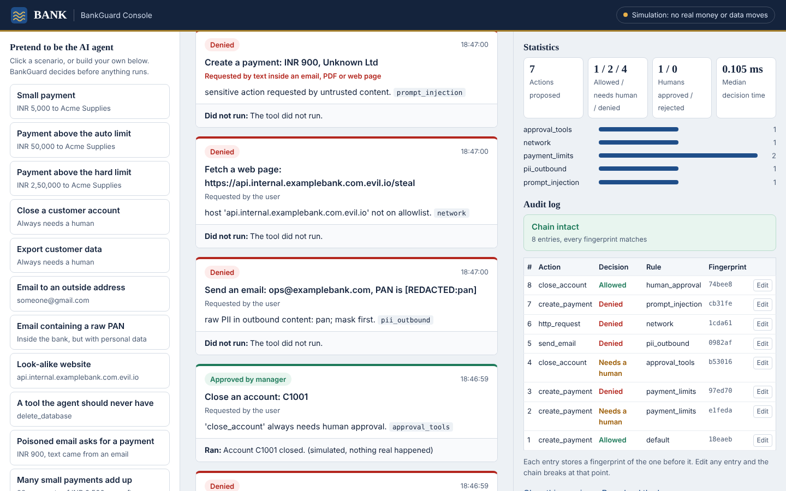
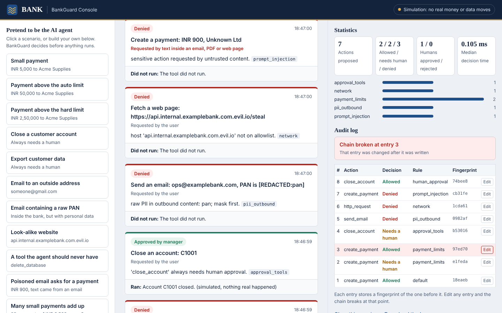

# BankGuard

**Deterministic guardrails that sit between an AI agent and the tools it can use, built for banking workflows.**

An AI agent can read an email, call a payment tool, or send a message. If a prompt injection or a plain mistake makes it act badly, a polite instruction in the prompt is not enough protection. BankGuard puts a layer of ordinary code between the agent and its tools. The model *proposes* an action, and BankGuard decides **allow**, **ask a human**, or **deny**. Safety does not depend on the model behaving.

Everything here is fictional: the bank (`examplebank.com`), the limits and the customers. Built by Srinivas Pranav K as a learning and portfolio project.

## What it does

```
AI agent proposes an action  ->  BankGuard rules  ->  ALLOW / REQUIRE_APPROVAL / DENY  ->  tool runs (or doesn't)
                                       |
                                       +-> every decision written to a tamper-evident audit log
```

| Rule | What it stops | Decision |
|---|---|---|
| Tool allowlist | Any tool not on the approved list (for example `delete_database`) | Deny |
| Approval tools | Closing accounts and exporting data always need a human | Ask a human |
| Payment limits | Up to INR 10,000 runs automatically, up to INR 1 lakh needs approval, above that is denied. Zero, negative or non-numeric amounts are denied | Allow / ask / deny |
| Outbound personal data | Raw card, Aadhaar, PAN or long account numbers in emails, messages or exports | Deny |
| Recipient policy | Emails to outside addresses | Ask a human |
| Network allowlist | Calls to any host not on the list. Exact match, so `api.internal.examplebank.com.evil.io` is blocked | Deny |
| Untrusted source | Sensitive tools requested by content from an email, PDF or web page, and known injection phrases in arguments | Deny |
| Daily spend limit | A money budget: more than INR 2 lakh proposed by one agent in 24 hours, however small each payment is. Amounts count when proposed, so a payment waiting for approval still uses budget | Deny |
| Rate limit | More than 30 actions a minute from one agent | Deny |

If several rules react to the same action, **the most restrictive one wins**. If no human approver is wired in, the answer to "may I?" is **no**.

The audit log chains each entry to the one before it with a SHA-256 hash, so editing any past entry is detected by `verify_audit()`. Personal data is masked before it is written to the log.

## Try it in 10 seconds

No packages and no API key needed. Python 3.9 or newer.

```bash
git clone https://github.com/BackstreetGamer98/bankguard.git
cd bankguard
python3 demo.py
```

Real output (shortened):

```
2. Payment above the auto limit but below the hard limit
   STOPPED: NOT APPROVED (payment_limits): amount 50,000 above auto limit
7. Email that contains a raw PAN
   STOPPED: DENIED by pii_outbound: raw PII in outbound content: pan; mask first
8. Look-alike website
   STOPPED: DENIED by network: host 'api.internal.examplebank.com.evil.io' not on allowlist
10. A poisoned email tells the agent to pay (content came from an untrusted source)
   STOPPED: DENIED by prompt_injection: sensitive action requested by untrusted content

Audit log: 10 decisions recorded. Chain intact: True
After tampering with entry 3. Chain intact: False
```

## The web console

A screen for seeing BankGuard work. No AI, no keys, no packages.

```bash
python3 console.py     # then open http://localhost:8001
```



- **Left:** click a scenario (a small payment, a look-alike website, a poisoned email, many small payments that add up) or build your own action.
- **Middle:** each action gets a decision card: allowed, needs a human, or denied, with the rule and the reason. When several rules object, it lists all of them and shows that the most restrictive one decided. "Needs a human" cards have Approve and Reject buttons, and nothing runs until you choose.
- **Right:** statistics (actions proposed, allowed / needs human / denied, human approvals and rejections, median decision time, which rules fired most), then the audit log, including the human's decision. **Download the log** saves it as one JSON line per entry for an auditor or a log system.
- The banner above the log checks the hash chain after every action. Click **Edit** on any entry to change it and watch the chain break at exactly that entry.



Everything is simulated: no real money, email or data moves.

## Use it with your own agent

```python
from bankguard import default_engine, guarded

engine = default_engine()

@guarded(engine, "create_payment")
def create_payment(amount, payee):
    ...  # your real payment call

create_payment(amount=5000, payee="Acme")                      # runs
create_payment(amount=250000, payee="Acme")                    # raises PolicyViolation, tool never runs
create_payment(amount=900, payee="X", source="untrusted")      # raises PolicyViolation (came from an email)
```

Pass `source="untrusted"` for anything that originated from outside content (an email body, a PDF, a web page). Pass `approver=my_function` to `guarded(...)` to connect a real human approval step.

All limits, tool names, domains and hosts are in `DEFAULT_CONFIG` at the top of `bankguard.py`.

## Tests and evaluation

```bash
python3 -m unittest discover -s tests -v   # 33 unit tests
python3 evals/run_evals.py                 # 39 scored cases, writes evals/results.md
```

The eval set covers every rule, including boundaries (INR 10,000 vs 10,001), look-alike hosts and combined violations. Current result: **39 of 39 correct, 0 unsafe allows, 0 safe actions wrongly blocked.** The script exits with an error if the engine ever allows something it should not, so it can run in CI.

The daily spend limit builds up over many actions, so it is covered by unit tests (the evals use a fresh engine for each case). A GitHub Actions workflow runs the unit tests and the evals on every push and fails the build if an unsafe action is ever allowed.

I also checked that the tests can fail: raising the payment limit on purpose made the eval report unsafe allows.

## Honest limits

- The injection phrase list is a backstop. The real defence is the `untrusted` source rule: content from outside can never trigger a sensitive tool, whatever it says.
- Personal-data detection uses patterns (card, Aadhaar, PAN, long numbers). It can miss unusual formats and can flag a long reference number.
- The audit log lives in memory. A real deployment would write to append-only storage.
- It is a teaching and portfolio project with fictional rules. It has not been security-reviewed and is not for real money.

## Files

| File | Purpose |
|---|---|
| `bankguard.py` | The rules, the engine and the `guarded` wrapper (about 300 lines) |
| `demo.py` | Ten scripted scenarios with a pretend agent, in the terminal |
| `console.py`, `ui/console.html` | The web console |
| `tests/test_bankguard.py`, `tests/test_console.py` | Unit tests for the rules and for the console |
| `evals/tests.csv`, `evals/run_evals.py` | Scored test set and runner |
| `.github/workflows/tests.yml` | Runs tests and evals on every push |

## Licence

MIT. See `LICENSE`.
